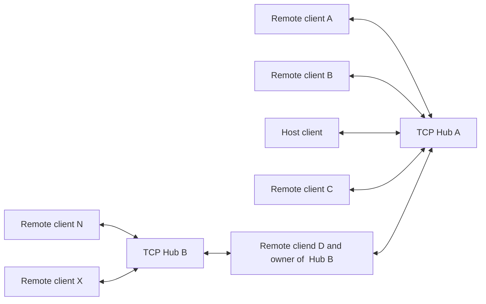

<div align="center">

# TCPTunnel

### A lightweight multiplayer TCP/Bluetooth chat for Windows cmd terminals

[](https://dotnet.microsoft.com/download/dotnet/10.0)
[](#requirements)
[](#how-it-works)
[](#building-from-source)

**Host a chat, connect multiple people, and keep everything inside one portable executable.**

</div>

---

TCPTunnel is a nostalgic Windows console chat brought back to 80's vibes with a stable asynchronous TCP core, an animated terminal interface, automatic UPnP port mapping, and a portable single-file application binary.

> [!IMPORTANT]
> End-to-end encryption is enabled by default for TCP and Bluetooth. Verify the owner's fingerprint through a trusted channel or use a trusted invitation. The owner is a member of the encrypted group and can read its messages.

## Highlights

| | Feature | Description |
|:--:|---|---|
| 🌐 | Multiplayer Hub | One process hosts the TCP Hub and connects the local user—no second console window required. |
| 💬 | Reliable chat | Ordered message delivery, preserved input during incoming messages, and clean disconnect handling. |
| 🖼️ | ASCII media | Drag a JPEG, PNG, GIF, or optional WebP into the input. GIF previews animate in-place without redrawing the whole console. |
| @  | Mentions | Existing participants are highlighted by `@durak go drink vodka`; direct mentions blink in-chat and request attention on the Windows taskbar. |
| 🧵 | Asynchronous server | Multiple clients are handled without creating a dedicated thread for every connection. |
| 🛡️ | Stability limits | Authentication timeout, message-size limits, rate limiting, duplicate nickname protection, and strict UTF-8 validation. |
| 🖥️ | ConsoleGraphics | Animated menu, bounded text rendering, fast frame drawing, and an optional classic plain-console mode. |
| 🔌 | UPnP / NAT-PMP | Attempts UPnP first, falls back to NAT-PMP, and removes the selected TCP mapping on shutdown. |
| 📦 | Two single-file builds | `TCPTunnel.exe` uses the installed .NET 10 Runtime and downloads its installer when it is missing; `TCPTunnel-selfcontained.exe` needs nothing installed. |
| 🎨 | Saved profiles | Nickname, recent endpoint, language, colors, and snake design are restored from a per-user profile. **(Testing)** |

## Recent updates

- Added safe ASCII image sharing for JPEG, PNG, and optional WebP sources without transmitting the original file or its metadata.
- Added animated GIF sharing with WIC frame composition, bounded frame timing, atomic Hub delivery, in-chat playback, and an animated `/look` viewer.
- Added consistent sender/receiver image sizing and the `/look` viewer for previews that need substantial downscaling.
- Expanded `.cfg` profiles with the full interface palette, live color previews, and reliable theme application after import.
- System messages, Hub startup notices, and the endpoint card now follow the configured system color instead of hard-coded success colors.
- Added the lightweight native launcher, automatic .NET 10 runtime check, and a reproducible lite publish command.

## Quick start

### [Download latest TCPTunnel release version](https://github.com/alextmsv/TcpTunnel/releases/latest)

Each release has two executables:

| File | Size | Requirements |
|---|---|---|
| `TCPTunnel.exe` | 8.93 MiB | [.NET 10 Runtime](https://dotnet.microsoft.com/download/dotnet/10.0) (x64). If it is missing, the browser downloads the installer and the window waits for a key press. |
| `TCPTunnel-selfcontained.exe` | 33.23 MiB | Nothing — .NET is built in. |

### Host a chat

1. Run `TCPTunnel.exe`.
2. Enter a nickname.
3. Select **Create server**.
4. Choose a TCP port or press <kbd>Enter</kbd> to use `9091`.
5. Share your public IP address and port with the other participants.
6. Have fun!

The Hub runs in the background of the same process, while the host connects locally through `127.0.0.1`. TCPTunnel displays the public IPv4 address from [ipify](https://api.ipify.org) when it can be resolved; otherwise it reports the fallback and shows the active local IPv4 address.
### Join a chat

1. Run `TCPTunnel.exe`.
2. Select **Connect to server**.
3. Enter the host name or IP address.
4. Enter the server port.
5. Have fun! x2

### Share an image

Drag exactly one `.jpg`, `.jpeg`, `.png`, or `.gif` file from Explorer into the chat input and press <kbd>Enter</kbd>. TCPTunnel decodes it locally, removes all container metadata, and sends a small 4-bit grayscale raster—not the original file, filename, or path. Paths containing spaces, Unicode characters or apostrophes are supported, including quoted paths and PowerShell-escaped apostrophes.

`.webp` follows the same flow when a compatible Windows Imaging Component codec is installed. If the codec is unavailable, the error remains local and the chat connection stays active.


https://github.com/user-attachments/assets/863f1a42-05b4-48f0-855a-0aa3d5ac829f


GIF frames are composed according to their disposal metadata and animate directly inside the existing chat rectangle. Large or heavily reduced images and GIFs remain compact inside the chat; use `/look` after the prompt to open the most recent one in a maximized plain console window.

### Chat commands

| Command | Action |
|---|---|
| `/help [command]` | Show a description on each command's own line, or detailed localized help for one command, including arguments, examples and permissions. |
| `/status` | Show the connected Hub's administrator, connection timing and participant count, plus your own running Hub and its port mapping. |
| `/whois nickname` | Show a participant's connection IP, session RTT, reported window size, snake and accepted message count. `@` is optional; the participant receives a highlighted notice. |
| `/ping <host:port>` | Check an endpoint locally without sending the command to other participants. |
| `/clear` | Clear only your local chat history while keeping the session and interface active. |
| `/look` | Open the most recent large image or GIF in a separate plain console window. |
| `/stop` | Hub owner: stop the local Hub. Participant: pause or resume their synchronized border snake. |
| `/kick nickname [reason]` | Local Hub owner: notify and disconnect one participant. The `@` prefix and quotes around a multiword reason are optional. |
| `/duel @pushkin` | Open duel settings and challenge a participant to a target-shooting match. |
| `/duel accept` | Accept a pending duel invitation. |
| `/exit` | Leave the current chat and return to the menu. |

**A literary disagreement?** Try `/duel @pushkin`, pick your settings, and send the challenge. Pushkin should join with `/duel accept`. The targets are circles, like Aimlabs.
## How it works



The Hub authenticates each nickname, receives length-prefixed UTF-8 messages, and broadcasts them to all other authenticated clients in a consistent order.
When you host one Hub and join another, `/status` shows both side by side when space permits. Port-mapping details belong only to your own Hub. Older servers keep chat working but cannot supply the new status or `/whois` metadata.

`/whois` uses the participant's existing connection for RTT measurements. Its message count includes each accepted text, image or complete GIF once. For the local administrator, a confirmed public Hub IPv4 replaces loopback; unavailable public discovery is reported explicitly. Window and snake data describe the participant's client. Unread `/whois` notices blink until visible in a focused classic console or acknowledged by input while visible; hidden notices are collected into a bounded reminder.

### Window and settings controls

In ConsoleGraphics settings, Up/Down select a row and Left/Right move backward/forward through its values. Enter retains the existing action. Older profiles acquire missing settings while preserving unknown fields and comments.

Classic console profiles store outer window width/height in pixels and maximized state. Windows Terminal owns its viewport: TCPTunnel preserves that geometry instead of forcing the old startup size. Restoring the outer Terminal window in pixels and reporting its pixel size in `/whois` are not yet supported.

### Bluetooth (testing)

**Create server** now opens hub options: `Public WWW hub [ <- ] LAN-only hub`, with `[ BT ]` for a Bluetooth-only hub and a separate Bluetooth checkbox for WWW/LAN hubs. A Bluetooth hub advertises a BLE beacon and accepts RFCOMM connections without pairing; TCP and Bluetooth participants share one chat. If Windows blocks BLE advertising (`AllowAdvertising`), TCPTunnel asks for administrator rights once and enables it.

**Connect to server** offers a Bluetooth search first. Found hubs are listed by signal strength with the owner, access mode and participant count. For Bluetooth participants `/whois` and `/status` show the signal level (reported by the client from the hub's beacon) instead of IP and ping.

LAN-only hubs skip port mapping and accept TCP only from on-link subnets of this computer. A router that rewrites external sources into local addresses cannot be distinguished by the hub. Mesh relaying is not implemented yet.

Hub options include **Hide IP addresses of clients**. When enabled, the server
returns only non-address diagnostics through `/whois`, including for queries
about yourself or the owner. Modified clients cannot request an unredacted reply.
The Hub's connection address remains visible to clients, and its operating system
necessarily knows the remote addresses of TCP connections.

### Protocol limits

- Maximum encoded frame: **16 KiB**
- Maximum chat message: **2,000 characters**
- Maximum image raster: **160 × 72**, packed at **4 bits/pixel**
- Maximum image control frame: **8 KiB**
- Maximum GIF: **500 frames**, **60 seconds**, **90–2,000 ms** per composed frame
- Authentication timeout: **7 seconds**
- Incomplete frame timeout: **30 seconds** from its first byte; idle chats keep waiting normally
- Incomplete GIF inactivity timeout: **180 seconds**; abandoned transfers release their partial frames without closing the chat
- Rate limit: **5 messages/second**, with a short burst allowance
- Image rate limit: **1 image per 5 seconds**, with a burst of 2
- Nickname length: **3–20 characters**, unique per Hub

## Command-line options

```text
TCPTunnel.exe [options]
```

| Option | Example | Description |
|---|---|---|
| `-nickname <name>` | `-nickname HeWhoMustNotBeNamed` | Set the nickname before opening the menu. |
| `-create <port>` | `-create 9091` | Start a Hub and connect to it locally. |
| `-connect <host:port>` | `-connect cool.tcptunnel.hub:9091` | Connect directly to a Hub. |
| `-ping <host:port>` | `-ping cool.tcptunnel.hub:9091` | Check whether a TCP endpoint is reachable. |
| `-no-graphics` | `-no-graphics` | Disable ConsoleGraphics without CG's option |
| `-graphics <on\|off>` | `-graphics off` | Explicitly enable or disable ConsoleGraphics. (Can be switched in CG's options)|
| `-self-test` | `-self-test` | Verify protocols, configuration parsing, localization, and command handling. |
| `-stress-test` | `-stress-test` | Run the loopback broadcast, framing, ordering, and targeted-disconnect stress suite. |
| `-lang <en/ru>` | `-lang ru (by default)` | Switch current language. Have the option in main menu. |

Example:

```powershell
TCPTunnel.exe -nickname VodkaMan -connect cool.tcptunnel.hub:9091 -graphics on -lang en
```

## Internet connectivity and NAT

TCPTunnel first attempts to create a UPnP mapping for the selected TCP port, then falls back to a renewable NAT-PMP lease. This works only when at least one of these protocols is enabled and supported by the router.

When a Hub starts, TCPTunnel makes a short HTTPS request to [ipify](https://www.ipify.org/) to determine the public IPv4 address shown to the host. No nickname or chat data is sent. If the request cannot be completed within three seconds, the Hub continues normally and displays the active local IPv4 address instead.

If other people cannot connect, check the following:

1. Allow `TCPTunnel.exe` through Windows Firewall.
2. Forward the selected TCP port manually on the host router.
3. Confirm that the ISP provides a public IP address.

> [!NOTE]
> UPnP cannot bypass strict NAT or carrier-grade NAT (CGNAT). Those networks require a public relay/VPS, a VPN with port forwarding, or another tunnelling solution.

## Encrypted chat

The server settings show **End-to-End encryption** after Bluetooth. `/status`
reports the established session as `E2E: TRUE/FALSE` and the owner's service state.
Unchecking the option creates a plaintext Hub. Remote plaintext connections require
an explicit `--allow-unencrypted` launch argument; there is no automatic fallback.

Profiles store `identityId` and `identityFingerprint` in `.cfg`. The private key
is a separate current-user DPAPI file under `%LocalAppData%\TCPTunnel\identities`.
Missing or damaged keys are not regenerated. A nickname remains reserved to its
approved key after disconnects; another key cannot enter using that nickname.

The owner uses `/invite`, which copies the public `tct2:` invitation to clipboard, and sends it through a trusted
channel. Paste it into the server-address prompt, or launch with
`-nickname yourName -invite "tct2:..."`. Bluetooth-only invitations connect directly
by RFCOMM. Without an invitation, the first connection requires entering the full
owner fingerprint after checking it through a trusted channel. The owner then
checks the client's fingerprint and runs `/approve nickname fingerprint`.
`/pending` lists numbered requests with the full key on its own line. `/pending 1` copies the key of request [1] without console borders or wrapping; `/identity` shows and copies the current profile fingerprint. Numbers are not reassigned during the current application run, and expired requests cannot be approved.
An invitation supplies trust information, not permission to read the room.

Membership changes rotate MLS keys. New arrivals cannot read old epochs; removed
members cannot read future epochs. `/kick` also revokes future admission for that
key. Text, images and complete GIF transfers are encrypted; `/look` passes media
through a private Windows pipe with process verification, without pixels in command
arguments or temporary GIF files. Saving dialogue history is a separate future feature.

`Hide IP addresses of clients` is enforced by the Hub's separate address-free reply
path, including over E2E; changing a client does not enable address disclosure.
Discovery beacons remain public and are not identity proofs. A compromised endpoint
can access the messages and keys available to that endpoint.

Verified owners are also pinned to the TCP hostname/port or Bluetooth device address.
A different key at an already trusted endpoint is rejected, including when it
claims a different room. A legitimate owner-key replacement requires an explicit
local trust reset and verification through a trusted channel. DNS aliases are
separate endpoints; invitations continue to pin the exact owner key.

Unauthenticated connections have a separate limit of 24, at most four per source,
with a bounded admission rate. They do not consume the 64 authenticated slots.
TLS handshakes have a 15-second deadline; manual approval remains available for
two minutes. Slow writers are isolated from the MLS room lock, and cancelled
queued messages release their capacity immediately.

Nicknames use normalized letters, digits, `_`, `-`, and `.`. Invisible and bidi
characters are rejected; Unicode confusable spellings cannot reserve an existing
identity. Old profile keys and room reservations are retained. An old nickname
that no longer meets these rules must be changed before connecting; migrating to
a new, unused nickname retains that loaded profile's key. Its new room nickname
needs approval. Selecting an existing profile continues to select its own key.

UPnP mappings use renewable leases. Bluetooth policy errors are explained without
changing system policy or launching the application with administrator privileges.
The native lite launcher excludes the working directory from DLL search and uses
Control Flow Guard and CET compatibility. Release builds are not Authenticode signed.

Windows CI builds the pinned crypto provider, audits its dependency lockfile,
runs regressions, and verifies both published executables. To compare a downloaded
file with a trusted release checksum, use `Get-FileHash <file> -Algorithm SHA256`.

Verify a ready EXE with `-e2e-test`. Crypto dependency licenses are embedded and can
be printed with `-third-party-notices`. The radio smoke test checks only the local
Bluetooth host; actual inter-computer radio transfer needs a second machine.

## Requirements

- Windows 10 or newer (Bluetooth requires Windows 10 1809 or newer)

`TCPTunnel.exe` requires the [.NET 10 Runtime](https://dotnet.microsoft.com/download/dotnet/10.0) (x64); the Desktop Runtime is not needed. Its native launcher checks this before starting managed code. When the runtime is missing, it downloads the official installer in the browser and waits for a key press so the message stays readable. `TCPTunnel-selfcontained.exe` includes .NET and has no requirements.

Building from source requires the [.NET 10 SDK](https://dotnet.microsoft.com/download/dotnet/10.0) or a newer SDK capable of targeting `net10.0-windows10.0.19041.0`.

Creating `TCPTunnel.exe` also requires Visual Studio Build Tools with **Desktop development with C++** and a Windows SDK. All builds require the MLS DLL built first with `build-crypto.ps1`: Rust 1.99.0 MSVC, Visual C++ tools, Windows SDK and cargo-audit are build dependencies. Users of a ready EXE do not need Rust.

## Building from source

### Visual Studio

1. Open `TCPTunnel.sln`.
2. Select the **Release** configuration.
3. Run `./build-crypto.ps1 -Configuration Release` once, then press <kbd>Ctrl</kbd> + <kbd>B</kbd> to compile and debug the project.
4. Open a terminal in the project directory and run `dotnet msbuild -t:PublishLite -p:Configuration=Release` and `dotnet msbuild -t:PublishSelfContained -p:Configuration=Release` to create both release executables.


   or just go [releases](https://github.com/alextmsv/TcpTunnel/releases/latest) lol

### Command line

```powershell
dotnet restore .\TCPTunnel.sln
.\build-crypto.ps1 -Configuration Release
dotnet build .\TCPTunnel.sln -c Release
.\build-lite.ps1 -Configuration Release
.\build-selfcontained.ps1 -Configuration Release
```

The publish scripts locate an installed .NET SDK even when `dotnet` is absent from
`PATH`, including a local SDK under `.dotnet` or `obj\audit-tools\dotnet`.
Use `-DotNetPath "C:\path\to\dotnet.exe"` to select an SDK explicitly.
The lite script also accepts `-VisualStudioPath "C:\path\to\BuildTools"` and
`-WindowsSdkPath "C:\path\to\Windows Kits\10"` for custom native tool installations.

Both release executables are created under:

```text
bin\Release\net10.0-windows\win-x64\publish\TCPTunnel.exe
bin\Release\net10.0-windows\win-x64\publish\TCPTunnel-selfcontained.exe
```

Each is a complete single file. `TCPTunnel.exe` extracts its managed payload under `%LocalAppData%\TCPTunnel\runtime` on first launch, then hosts it inside the original process. `TCPTunnel-selfcontained.exe` is a standard compressed .NET single-file build that runs its self-test during the build. Trimming and NativeAOT are intentionally disabled to preserve compatibility.

The Lite executable is **8.93 MiB**. It extracts about 30 MiB under `%LOCALAPPDATA%\TCPTunnel\runtime`. The self-contained executable is **33.23 MiB**. On first launch it extracts its bundled EXE (about 100 MiB) under `%LOCALAPPDATA%\TCPTunnel\self-contained` and reuses it on subsequent launches. Building either launcher requires the Visual C++ tools and Windows SDK. The size gates are **32 MiB** for Lite and **64 MiB** for self-contained.

The immutable `default.cfg` is embedded in that executable. Personal profiles are generated under `%LocalAppData%\TCPTunnel\profiles`; they are runtime data and do not need to be distributed with the program.

Verify a copied executable at any time:

```powershell
.\TCPTunnel.exe -self-test
```

Run `TCPTunnel.exe -stress-test` to additionally check session cleanup across Hub restarts,
partial-frame deadlines, abandoned GIF transfers, shared send-buffer ownership, queue limits,
slow-recipient isolation, and ordered loopback broadcasts.

Expected output:

```text
TCPTunnel self-test: OK
```

## Project structure

```text
TCPTunnel
├── Broadcaster.cs              # Ordered multi-client broadcasting
├── Bootstrapper/               # Native .NET 10 check and in-process launcher
├── ApplicationSettings.cs      # Atomic per-user profile persistence
├── Client.cs                   # Client state, sending, and rate limits
├── ConsoleGraphic.cs           # Console frame and bounded output
├── ConsoleTitleAnimator.cs     # Console title live animation, works only when CG's ON
├── ConsoleTheme.cs             # Customizable terminal color palette
├── ImageCodec.cs               # Safe image decoding and grayscale packing
├── ImageCodec.Animation.cs     # Bounded WIC GIF decoding and frame composition
├── ImageInput.cs               # Drag-and-drop image path recognition
├── ImageProtocol.cs            # Compact image transfer frames and validation
├── ImageAnimationProtocol.cs   # Ordered BEGIN/FRAME/END animation transport
├── ImageRenderer.cs            # Stable ASCII conversion and chat previews
├── ImageViewer.cs              # Separate full-size /look console viewer
├── LegacyEventProtocol.cs      # Safely ignores event packets from older releases
├── Localization.cs             # Translations container
├── Menu.cs                     # Menu and launch arguments
├── MessageProtocol.cs          # Length-prefixed UTF-8 protocol
├── NetworkAddressResolver.cs   # Public/local IPv4 discovery and endpoint formatting
├── NetWorker.cs                # Authentication, sessions, UPnP, and NAT-PMP
├── ServerInterface.cs          # Hub lifecycle and accept loop
├── SnakeProtocol.cs            # Custom UI-snake profile transmission
├── StabilityTests.cs           # Loopback network stress checks
├── SystemMessageProtocol.cs    # "Language" for system ivents
├── UserInterface.cs            # Interactive chat and input rendering
├── WindowAttention.cs          # Windows taskbar attention notifications
├── build-lite.ps1              # Reproducible lightweight release builder
```

## Roadmap

E2E chat is implemented with OpenMLS for TCP and Bluetooth RFCOMM. New Hubs enable
it by default. The owner is a visible MLS participant whose coordinator runs in
the Hub process; that process holds the owner's keys and decrypted messages.
See [the implementation and protection boundaries](ENCRYPTION_DESIGN.md) and
[crypto build instructions](NativeCrypto/README.md). Independent security auditing
and a two-computer physical RFCOMM test have not been performed here.

- [V] Add english language support
- [V] End-to-end encrypted chat
- [ ] Relay mode for strict NAT and CGNAT
- [ ] Improved connection discovery and invitations
- [ ] Automated integration tests

---

<div align="center">

Made with nostalgic vibes by **alextmsv**.

</div>
